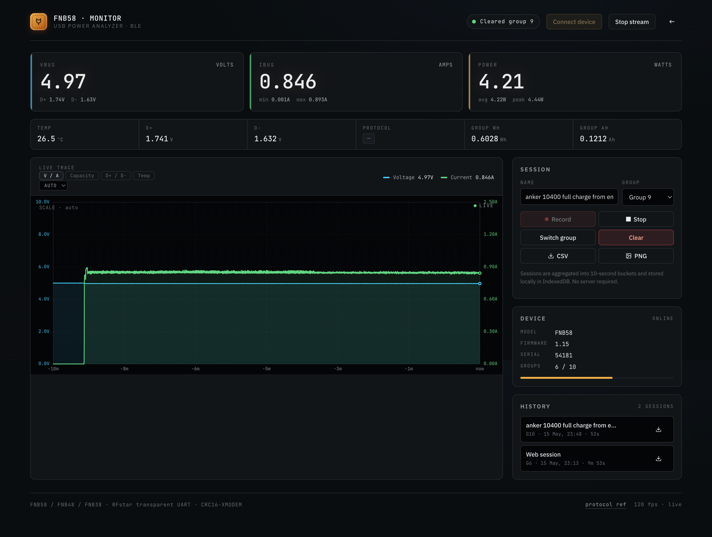
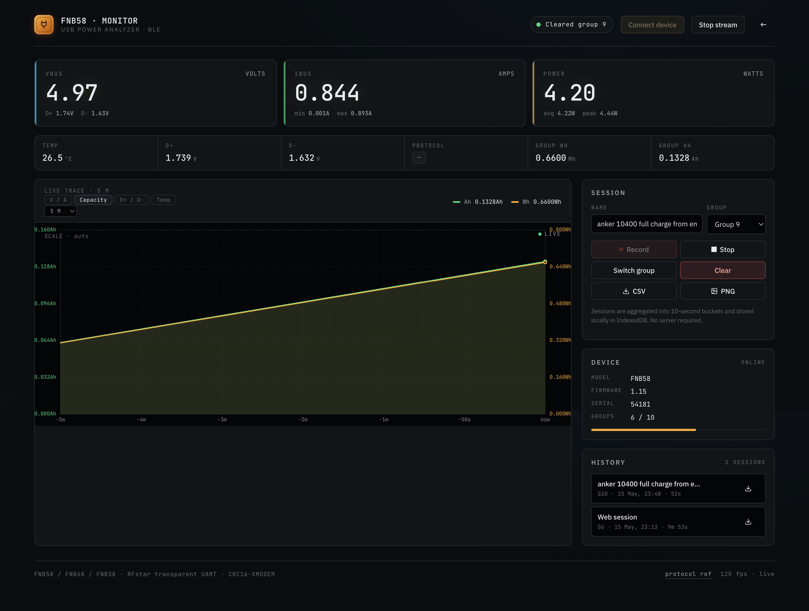

# FNB58 Web BLE Monitor

A **zero-install, single-file web app** that connects to the **FNIRSI FNB58 / FNB48 / FNB38** USB power meter over Bluetooth Low Energy — directly from your browser.

No Python. No install. No server. Just open the page, pair your device, and go.



*Live V/A trace — real-time voltage and current with a dual-axis canvas graph.*



*Capacity tab — accumulated Ah and Wh plotted over time.*

---

## Requirements

- **Chrome** or **Edge** (Web Bluetooth API is not available in Firefox/Safari)
- A **FNIRSI FNB58** (or FNB48/FNB38) with BLE

---

## Quick Start

### Option 1: Use the hosted app

👉 **[fnb58.ai-sommelier.co.uk](https://fnb58.ai-sommelier.co.uk)** — always-on, served over HTTPS.

Or via GitHub Pages: **[pgodlews.github.io/fnirsi-fnb58-web-monitor](https://pgodlews.github.io/fnirsi-fnb58-web-monitor)**

### Option 2: Download and open locally

```bash
# Download
curl -O https://raw.githubusercontent.com/pgodlews/fnirsi-fnb58-web-monitor/main/index.html

# Serve over localhost (required for Web Bluetooth)
python3 -m http.server 8080

# Open http://localhost:8080
```

### Option 3: Copy-paste

The entire app is a single `index.html` file. Just save it and open it via `http://localhost`.

---

## Features

| Feature | Description |
|---------|-------------|
| **Auto Scan** | Browser-native BLE picker filters for `FNB*` devices |
| **Live Stream** | Real-time voltage, current, power, D+/D−, temperature, protocol |
| **Canvas Graph** | Dual-axis live plot with selectable window (60 s … 24 h or auto), dark theme |
| **Chart Tabs** | Switch between V/A, accumulated Capacity (Ah/Wh), D+/D−, and Temperature |
| **Protocol Estimate** | D+/D− heuristics for QC 2.0/3.0, FCP, SCP and VOOC; PD/PPS cannot be identified from these signals |
| **Session Logging** | 10-second aggregate buckets stored in browser (IndexedDB) |
| **CSV Export** | Download any session as CSV, with local-timezone timestamps |
| **PNG Export** | Screenshot any chart tab, stamped with the start→end time |
| **Group Control** | Switch / clear the device's 10 cumulative Wh/Ah groups |

Protocol names are estimates, not decoded negotiations. USB-C PD and PPS use
the CC line; idle D+/D− lines therefore show unknown (`—`), not DCP. These
estimates should not be used to diagnose a failed PD negotiation.

## Development checks

The hosted app still has no runtime dependencies or build step. To run the
regression checks with Node.js 22 or later:

```bash
npm ci
npm test
```

The checks use simulated BLE notifications, a canvas/DOM stub and IndexedDB
emulation. Actual meter compatibility still needs a hardware check in Chrome
or Edge.

---

## BLE Protocol

The FNB58 exposes an **RFstar transparent UART** over BLE:

| Service | Characteristic | Direction |
|---------|---------------|-----------|
| `ffe0` | `ffe4` | Device → Host (notifications) |
| `ffe5` | `ffe9` | Host → Device (write) |

Init sequence:
1. `AA 81 00 F4` → `ffe9`
2. Wait 2s
3. `AA 82 00 A7` → `ffe9`

Stream frames on `ffe4`: `AA [type] [len] [data…] [checksum]`

Checksum = low byte of CRC16-XMODEM (`poly 0x1021`).

| Type | Len | Content |
|------|-----|---------|
| `0x03` | 14 | Device info (model, firmware, SN, groups) |
| `0x05` | 7  | Temperature (°C) |
| `0x06` | 6  | D+ / D− voltage |
| `0x07` | 4  | VBUS / IBUS |
| `0x08` | 17 | Group Wh / Ah / time |

---

## Credits

- **[OpenFNB58](https://github.com/yeckel/OpenFNB58)** by [Tomáš Yekl](https://github.com/yeckel) — Protocol reference, init commands, packet layouts
- **FNIRSI** — For the FNB58, a genuinely useful USB power meter

---

## License

GPL-3.0 (same as OpenFNB58).

The web application — including the browser UI, the dual-axis canvas chart and
its V/A, Capacity, D+/D− and Temperature tabs, the selectable time window,
IndexedDB session recording, CSV and timestamped PNG export, demo mode and
disconnect freeze — are copyright © 2026 Piotr Godlewski, and are licensed
under GPL-3.0.
